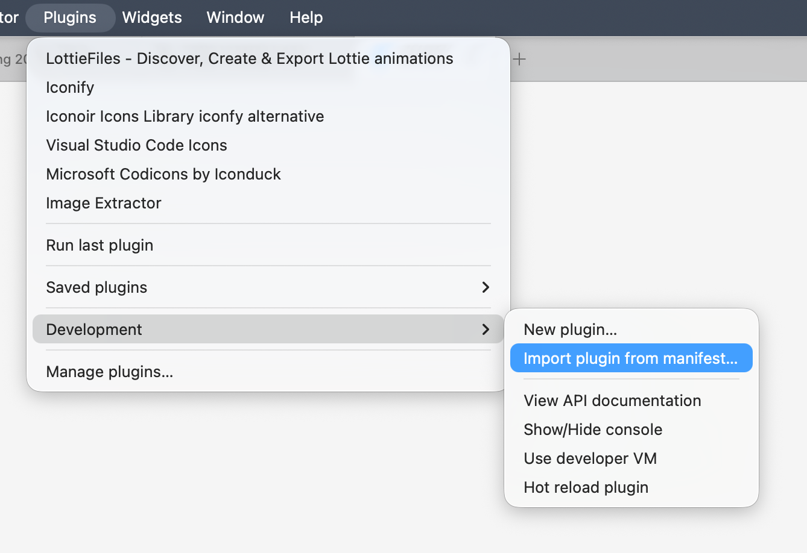

# Pixel Lab Motion Export

A Figma plugin that exports animations for the Pixel Lab player.

## Install

1. Download [pixel-lab-motion-export.zip](https://github.com/thinkpixellab/figma-motion/releases/latest/download/pixel-lab-motion-export.zip) and unzip it.
2. In the Figma desktop app, go to **Plugins > Development > Import plugin from manifest**.

    

3. Choose the `manifest.json` file from the unzipped folder.

## Update

Repeat the install steps with a fresh download. The plugin shows a notice when a new version is available.

## Network access

The plugin only contacts `raw.githubusercontent.com`, to check whether a new version is available.

## Named layers

Start a layer's name with `@` to make it a named layer. Everything after the `@` is its name, so a layer called `@center` is named `center`. A named layer is always kept in the export, even when it draws nothing, so the page can find it by name. Its keyframes become named points in time: a `@loop` layer with a keyframe at 1.2 seconds marks 1.2 seconds as `loop`.

- Use letters, digits and hyphens after the prefix, and give every named layer its own name.
- To keep a named layer out of sight, set its opacity to 0%. A hidden layer is left out of the export, so the plugin will not export a hidden named layer.
- Only keyframes on the named layer itself count, not keyframes on the layers inside it.

The plugin will not let you export until every named layer follows these rules, and lists the layers to fix.

To use a different prefix, change **Named layer prefix** under **General export settings**. The prefix is saved in the Figma file, so everyone exporting from that file uses the same one.
