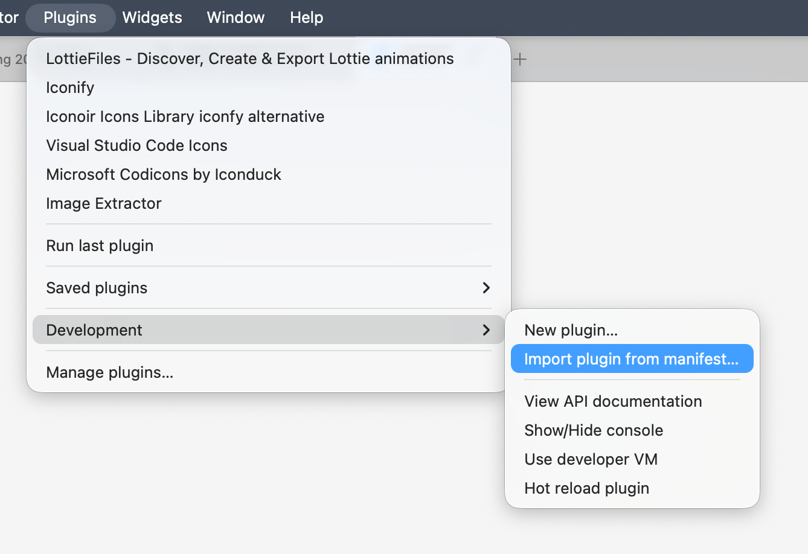

# Pixel Lab Motion Export

A Figma plugin that exports animations for the Pixel Lab player.

## Install

1. Download [pixel-lab-motion-export.zip](https://github.com/thinkpixellab/figma-motion/releases/latest/download/pixel-lab-motion-export.zip) and unzip it.
2. In the Figma desktop app, go to **Plugins > Development > Import plugin from manifest**.

    

3. Choose the `manifest.json` file from the unzipped folder.

## Update

Repeat the install steps with a fresh download. The plugin shows a notice when a new version is available.

## Network access

The plugin only contacts `raw.githubusercontent.com`, to check whether a new version is available.
